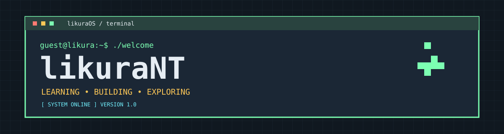

<div align="center">



### `> WELCOME TO MY TERMINAL_`


</div>

---

### `01 / WHOAMI`

```bash
$ whoami
> likuraNT

$ cat about.txt
> CyberSecurity engineer and student.
> Curious about computers and how things work.
> Always learning something new.

$ echo $STATUS
> ONLINE
```

---

### `02 / MY TOOLBOX`

<div align="center">


</div>

---

### `03 / SYSTEM STATS`

<div align="center">


</div>

---

### `04 / ACTIVITY LOG`

```text
[ OK ] Terminal initialized
[ OK ] Profile loaded
[ OK ] Learning mode enabled

> Keep exploring.
```

<!-- Snake animation will be added here later. -->

---

<div align="center">

### `CONNECTION ESTABLISHED`

[GitHub](https://github.com/likuraNT)

`[ PRESS START TO CONTINUE ]`

`© likuraNT • powered by curiosity`

</div>
